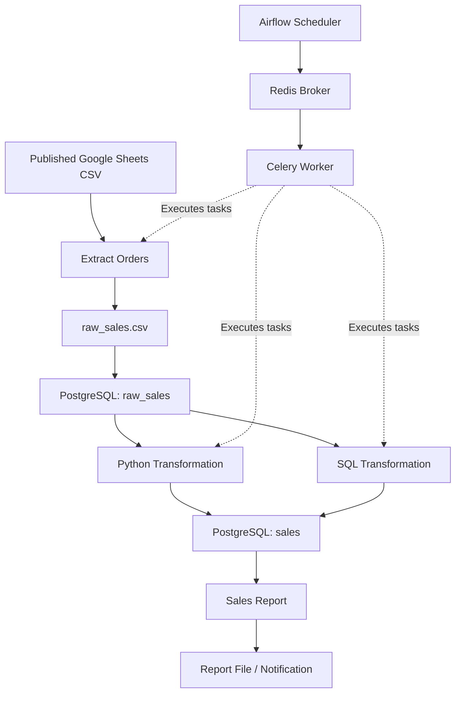

# Data Pipeline Orchestration with Apache Airflow

> A hands-on data engineering project demonstrating workflow orchestration, ETL pipelines, SQL transformations, TaskFlow API, XCom, branching, and automated notifications using Apache Airflow.

## Project Overview

This project demonstrates how Apache Airflow can be used to automate, schedule, monitor, and manage data engineering workflows.

The implementation progresses from a basic DAG with Bash and Python operators to a modular ETL pipeline that extracts sales data from Google Sheets, loads it into PostgreSQL, transforms the data, and generates reports.

The project also explores SQL-based orchestration, TaskFlow API, XCom, branching, Airflow Variables, and email notifications.

The original instructional repository is [Najeeb-Sulaiman/orchestration-with-airflow](https://github.com/Najeeb-Sulaiman/orchestration-with-airflow). The implementation was adapted to a local Windows development environment using Docker Desktop, WSL2, and Apache Airflow 3.2.2.

## Project Objectives

- Set up Apache Airflow in a containerized development environment.
- Understand DAG creation, task dependencies, and workflow scheduling.
- Build an automated extract, load, transform, and reporting pipeline.
- Integrate Apache Airflow with PostgreSQL.
- Execute data transformations using Python and SQL.
- Use TaskFlow and XCom for communication between tasks.
- Implement conditional branching, retries, and notifications.
- Monitor and troubleshoot DAG executions.
- Understand practical considerations for operating data pipelines.

## Technology Stack

| Technology | Purpose |
| --- | --- |
| Apache Airflow 3.2.2 | Workflow orchestration |
| Python | DAG definitions and ETL logic |
| Docker and Docker Compose | Containerized development environment |
| WSL2 | Linux backend on Windows |
| PostgreSQL 16 | Relational data storage |
| Redis | Celery message broker |
| CeleryExecutor | Distributed task execution |
| Pandas | Data extraction, cleaning, and analysis |
| SQLAlchemy and psycopg2 | PostgreSQL connectivity |
| PostgresHook | Airflow-native database integration |
| SQLExecuteQueryOperator | SQL orchestration |
| Git and GitHub | Source control |

## System Architecture



The Python and SQL transformation paths represent alternative DAG implementations. They are not intended to run concurrently against the same target tables.

## Repository Structure

```text
orchestration-with-airflow/
├── airflow/
│   ├── Dockerfile
│   ├── docker-compose.yaml
│   └── dags/
│       ├── 00_first-dag.py
│       ├── 01_orders.py
│       ├── 02_orders-sql.py
│       ├── 03_taskflow.py
│       ├── 04_orders-email.py
│       ├── include/
│       │   ├── config.py
│       │   ├── orders_util.py
│       │   └── orders_email.py
│       ├── sql/
│       │   └── orders.sql
│       └── data/                  # Local pipeline output
└── fundamentals/
    ├── stage0-manual/
    ├── stage1-one-big-script/
    ├── stage2-cron/
    ├── stage3-custom-orchestrator/
    └── steps/
```

## Airflow DAGs

### 1. Basic DAG: first_dag

**File:** `00_first-dag.py`

Introduces Apache Airflow operators and task dependencies.

- `first_task`: BashOperator that prints a message.
- `second_task`: PythonOperator that executes a Python function.

```text
first_task >> second_task
```

Both tasks were successfully executed and verified through Airflow task logs during development.

### 2. Python ETL Pipeline: orders

**Files:** `01_orders.py` and `include/orders_util.py`

This workflow extracts sales records, loads them into PostgreSQL, transforms the data, and generates a report.

```text
extract_orders
      |
      v
load_orders
      |
      v
transform_orders
      |
      v
notify_orders
```

| Task | Description |
| --- | --- |
| extract_orders | Extract sales data from a published Google Sheets CSV |
| load_orders | Load extracted records into the raw_sales PostgreSQL table |
| transform_orders | Clean records, remove duplicates, process dates, and calculate sales |
| notify_orders | Aggregate sales metrics and generate a text report |

The primary derived field is:

```python
total_sale = quantity * price
```

The reporting stage calculates:

- Total number of orders
- Total quantity sold
- Total revenue
- Top customer by revenue
- Top product by revenue

### 3. SQL ETL Pipeline: orders_sql

**Files:** `02_orders-sql.py` and `sql/orders.sql`

This DAG demonstrates database-side transformations using `SQLExecuteQueryOperator`.

The extraction and loading stages are handled in Python, while the transformation executes SQL against PostgreSQL.

```text
extract_orders
      |
      v
load_orders
      |
      v
SQLExecuteQueryOperator
      |
      v
notify_orders
```

This approach separates SQL transformation logic from the DAG definition.

**Important:** The Python and SQL Orders pipelines replace similarly named database tables. They should be executed separately in this learning environment.

### 4. TaskFlow API and XCom

**File:** `03_taskflow.py`

This DAG introduces Airflow's TaskFlow API, task context, and XCom.

The workflow demonstrates:

- Defining tasks using `@dag` and `@task`.
- Accessing task execution context.
- Pushing values through XCom.
- Retrieving XCom values in downstream tasks.

XCom enables communication between tasks without manually creating an external intermediate file for small task messages.

### 5. Email Notifications and Branching

**Files:** `04_orders-email.py` and `include/orders_email.py`

This workflow introduces more advanced orchestration features:

- BranchPythonOperator for conditional execution.
- Airflow Variables for runtime configuration.
- XCom for passing report information.
- EmailOperator for notifications.
- Task retries and retry delays.
- Cleanup tasks.

The branch determines whether processing should continue or a no-record notification should be generated.

Email functionality requires a configured SMTP connection and authorized recipient addresses.

## Local Development Environment

The project was developed on Windows using Docker Desktop and WSL2.

### WSL2 Configuration

The development environment used the following WSL2 resource limits:

```ini
[wsl2]
memory=5GB
processors=4
swap=2GB
```

These settings were chosen for the available hardware and are not universal requirements.

### Docker Compose Configuration

The local installation used:

```dotenv
COMPOSE_PROJECT_NAME=airflow_learning
AIRFLOW_IMAGE_NAME=apache/airflow:3.2.2
AIRFLOW_UID=50000
```

Additional local adjustments included:

- Mapping the Airflow API server to port 8081.
- Setting Celery worker concurrency to 2.
- Preserving PostgreSQL and Redis volumes.
- Isolating the project from an older Airflow installation.

The upstream Dockerfile uses Airflow 3.3.2. The documented local setup retained Airflow 3.2.2.

## Installation and Setup

### Prerequisites

- Docker Desktop
- WSL2
- Git
- Python development environment
- Visual Studio Code
- Sufficient memory and disk space for the Airflow services

### Clone the Repository

```powershell
git clone https://github.com/Najeeb-Sulaiman/orchestration-with-airflow.git

cd orchestration-with-airflow/airflow
```

### Configure Environment Variables

Create the local `.env` file using the configuration required by your Docker Compose setup.

Do not commit passwords, database connection strings, SMTP credentials, or other secrets.

### Validate Docker Compose

```powershell
docker compose config --quiet
```

### Start Airflow

For an existing initialized environment:

```powershell
docker compose up -d
```

For a fresh installation, complete the one-time database initialization required by the Compose configuration before starting the Airflow services.

### Check Services

```powershell
docker compose ps
```

The main services are:

- airflow-apiserver
- airflow-scheduler
- airflow-dag-processor
- airflow-worker
- airflow-triggerer
- postgres
- redis

### Open Airflow

The local Airflow UI is accessible at:

**http://localhost:8081**

Use the credentials configured for the local installation.

## PostgreSQL Configuration

The locally adapted Orders pipeline uses the Airflow connection:

```text
orders_local_postgres
```

Example connection configuration:

| Setting | Value |
| --- | --- |
| Connection ID | orders_local_postgres |
| Connection Type | Postgres |
| Host | postgres |
| Database | airflow |
| Username | airflow |
| Port | 5432 |
| Password | Configured locally |

The local exercise uses the existing PostgreSQL container. A separate application database is recommended for production deployments.

### Verify Database Access

```powershell
docker compose exec -T postgres psql -U airflow -d airflow -c "SELECT current_database(), current_user;"
```

## Running and Validating DAGs

### Check DAG Import Errors

```powershell
docker compose exec -T airflow-scheduler airflow dags list-import-errors
```

A successful import check returns:

```text
No data found
```

### List Orders Tasks

```powershell
docker compose exec -T airflow-scheduler airflow tasks list orders
```

Expected task IDs:

```text
extract_orders
load_orders
notify_orders
transform_orders
```

### Trigger a DAG

1. Open the Airflow UI.
2. Locate the target DAG.
3. Unpause the DAG if necessary.
4. Select Trigger.
5. Inspect task execution states.
6. Review task-instance logs.

### Verify PostgreSQL Outputs

Check the raw table:

```powershell
docker compose exec -T postgres psql -U airflow -d airflow -c "SELECT COUNT(*) FROM raw_sales;"
```

Check transformed sales:

```powershell
docker compose exec -T postgres psql -U airflow -d airflow -c "SELECT COUNT(*) AS order_count, SUM(total_sale) AS total_revenue FROM sales;"
```

The expected local output files are:

```text
airflow/dags/data/raw_sales.csv
airflow/dags/data/report.txt
```

### Execution Evidence

For a portfolio presentation, add screenshots or saved evidence of:

- Successful DAG runs
- Task dependencies in the DAG graph
- Task-instance logs
- Raw and transformed PostgreSQL records
- Generated report output
- Email notification results, where applicable

Record counts, revenue totals, and email delivery outcomes should be taken from actual execution results rather than assumed.

## Challenges and Troubleshooting

### 1. Docker Engine Instability

**Issue:** Docker Desktop returned HTTP 500 errors and sometimes failed during startup.

**Approach:** Inspect Docker Engine health, restart WSL2 when necessary, and investigate container resource usage.

### 2. Duplicate Airflow Environments

**Issue:** Two Airflow Compose projects were running simultaneously.

**Approach:** Identify containers by their Docker Compose project labels and stop the old environment without deleting its data.

### 3. Resource Constraints

**Issue:** Multiple Airflow processes consumed significant memory and CPU resources.

**Approach:** Reduce Celery worker concurrency, limit unnecessary workload, and monitor usage with:

```powershell
docker stats --no-stream
```

### 4. DAG and Configuration Issues

**Issue:** The updated repository changed file locations and introduced dependencies on PostgreSQL connections and provider packages.

**Approach:** Verify Python imports, confirm connection IDs, review DAG definitions, and inspect task dependencies.

### 5. Database Transaction Handling

**Issue:** Database writes require reliable transaction handling.

**Approach:** Use SQLAlchemy transaction contexts such as `engine.begin()` and consistent database connections across ETL tasks.

### 6. SQL Transformation and Reporting

**Issue:** The original SQL projection omitted columns required by the report-generation task.

**Approach:** Preserve the customer and product fields needed for downstream aggregation.

## Key Lessons Learned

This project provided practical experience with:

1. Designing and executing task dependencies in Apache Airflow.
2. Building modular ETL workflows with Python.
3. Integrating Airflow with PostgreSQL.
4. Comparing Python-based and SQL-based transformations.
5. Passing data between tasks using XCom.
6. Using TaskFlow decorators and task context.
7. Implementing conditional branching and notifications.
8. Troubleshooting Docker, Celery workers, and DAG execution.
9. Monitoring data pipeline execution through logs and task states.
10. Managing configuration and dependencies in a containerized environment.

## Future Improvements

Potential improvements include:

- Separate PostgreSQL databases for Airflow metadata and business data.
- Automated data quality checks.
- Schema validation at ingestion.
- Incremental loading and idempotent transformations.
- Automated DAG testing and CI pipelines.
- Better secret and credential management.
- Centralized logging and monitoring.
- Improved error handling and retry policies.
- Production-grade email and alerting configuration.
- Data warehouse integration.

## Acknowledgment

This project was implemented as a practical Apache Airflow learning exercise based on the instructional repository:

**[Najeeb-Sulaiman/orchestration-with-airflow](https://github.com/Najeeb-Sulaiman/orchestration-with-airflow)**

The local implementation includes Windows/WSL2 setup, Docker Compose customization, PostgreSQL connection configuration, ETL code adjustments, and troubleshooting.

## Project Summary

The project demonstrates how Apache Airflow can replace manually coordinated scripts with defined, observable workflows for extraction, loading, transformation, reporting, and notification.

It provides practical experience with workflow orchestration, task dependencies, database operations, containerized infrastructure, and operational troubleshooting.

---

**Project Type:** Data Engineering / Workflow Orchestration  
**Primary Tool:** Apache Airflow  
**Environment:** Windows, WSL2, Docker Desktop  
**Language:** Python / SQL  
**Documentation Updated:** November 2026
